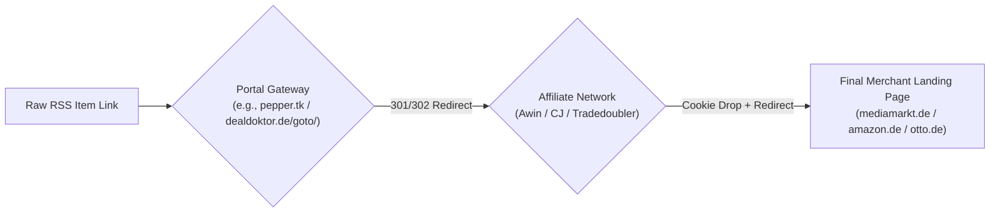
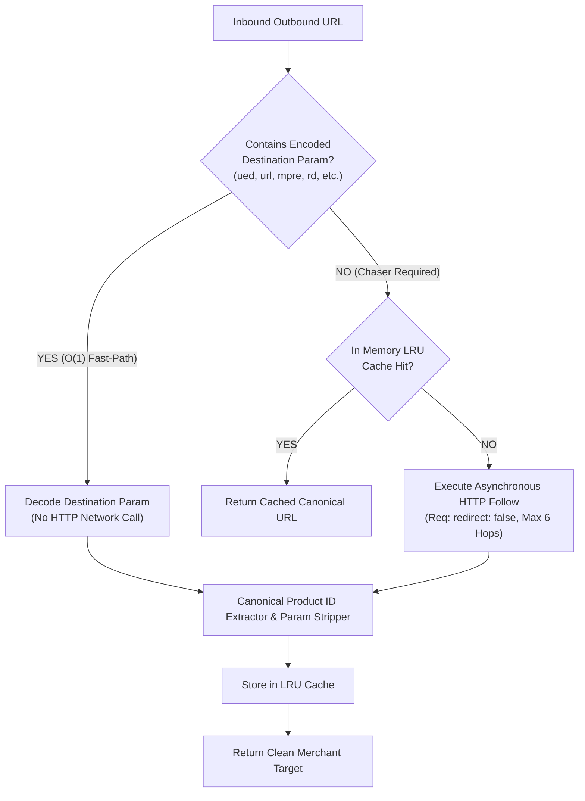
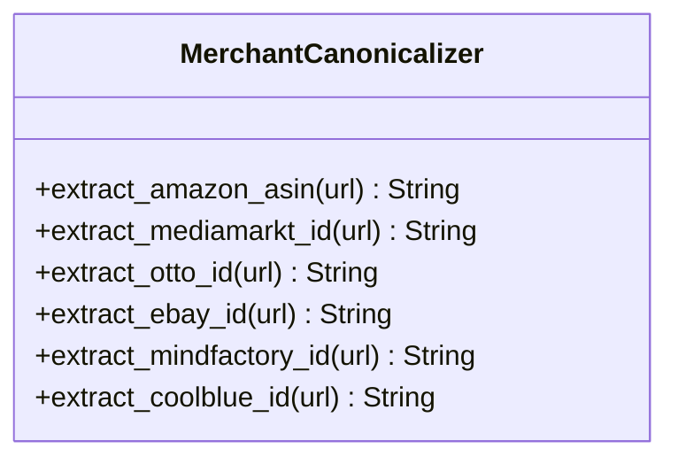
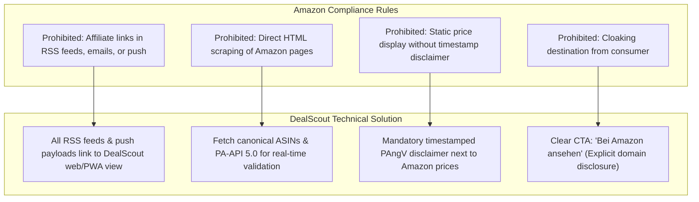
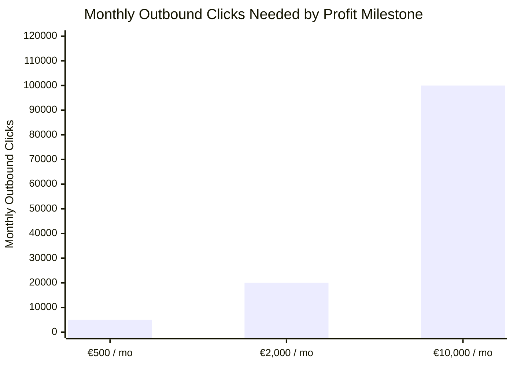
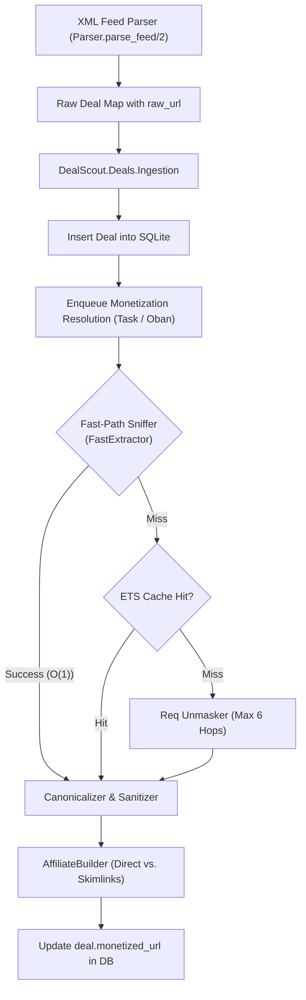
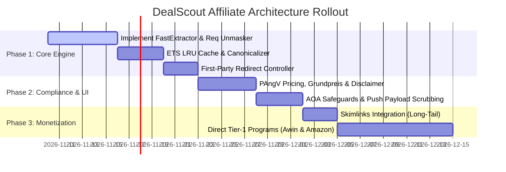

# Automated Affiliate Monetization, Link Unmasking & Network Compliance

> **Document Status**: Production Architecture & Compliance Specification  
> **Author**: Technical Architecture & AdTech Compliance Research  
> **Target System**: DealScout (Elixir 1.18 / Phoenix 1.8 LiveView / SQLite)  
> **Classification**: Proprietary Commercial Strategy & Engineering Blueprint  

---

## Executive Summary

DealScout aggregates real-time bargain feeds from German consumer deal portals (*MyDealz / Pepper.com*, *DealDoktor*, *MonsterDealz*, *Schnäppchenfuchs*, *Mein-Deal*). In their raw feed state, outbound deal URLs point to portal-owned tracking redirects (`pepper.tk`, `dealdoktor.de/goto/`, `mein-deal.com/goto/`) or third-party affiliate networks (*Awin*, *Tradedoubler*, *CJ*, *Amazon Associates*).

Currently, this architecture produces two critical failures:
1. **Zero Platform Monetization**: 100% of outbound merchant traffic attributes revenue to the original aggregating portals. DealScout subsidizes infrastructure and push notifications while capturing €0 gross margin.
2. **Ad-Blocker Link Breakage**: Privacy and ad-blocking extensions (uBlock Origin, Pi-hole, Brave Shields, AdGuard) aggressively block known affiliate tracking domains (`awin1.com`, `tradedoubler.com`, `pepper.tk`). DealScout users clicking deals encounter `ERR_BLOCKED_BY_CLIENT` or blank interstitial tabs, degrading retention.

This research report presents the complete end-to-end engineering, legal compliance, and economic blueprint for DealScout:
- **Technical Mechanics**: Programmatic redirect unmasking via Elixir/Req, zero-network-call O(1) tracking parameter extraction, browser fingerprint emulation, canonical product identifier parsing (Amazon ASIN, MediaMarkt MMS-ID, Otto, eBay), and parameter stripping.
- **Monetization Engine**: Direct network integration vs. sub-affiliate aggregator networks (*Skimlinks*, *Sovrn*), presenting a high-margin Hybrid Gateway Architecture.
- **Strict Network & Legal Compliance**: Amazon Associates Operating Agreement (AOA) compliance, avoidance of RSS/push affiliate penalties, German Price Indication Ordinance (*Preisangabenverordnung - PAngV* § 4, § 6, § 11 30-day lowest price rule), and Telecommunications-Telemedia Data Protection (*TDDDG* / *DDG* / *UWG* § 5a).
- **Unit Economics**: Granular DACH e-commerce benchmarks (Conversion Rates, AOV, EPC, return rates / *Stornoquoten*) and financial roadmaps to €500/mo, €2,000/mo, and €10,000/mo in net affiliate profit.
- **Implementation Architecture**: Production-ready, non-blocking Elixir modules featuring an asynchronous unmasking pipeline, domain-keyed token bucket rate-limiting, ETS LRU caching, and first-party click redirect routing.

---

# Table of Contents
1. [The Technical Mechanics of Clean Link Resolution & Affiliate Swapping](#1-the-technical-mechanics-of-clean-link-resolution--affiliate-swapping)
   - 1.1 Anatomy of Deal Portal Redirects
   - 1.2 Programmatic Unmasking: Fast-Path vs. Network Chasing
   - 1.3 Bot Protection Mitigations & Request Fingerprinting
   - 1.4 Canonical Product Identifier Extraction
   - 1.5 Tracking Parameter Stripping & URL Normalization
   - 1.6 Affiliate Link Injection: Direct Networks vs. Aggregator Fallback
2. [Compliance & Program Policies (Legal & TOS Safeguards)](#2-compliance--program-policies-legal--tos-safeguards)
   - 2.1 Amazon Associates Operating Agreement & Policy Constraints
   - 2.2 Awin, Tradedoubler & Enterprise Publisher Guidelines
   - 2.3 German Price Indication Ordinance (PAngV 2022 / EU Omnibus Directive)
   - 2.4 German Telecommunications-Telemedia Data Protection Act (TDDDG) & UWG Advertising Disclosures
3. [Unit Economics & Revenue Projections in DACH](#3-unit-economics--revenue-projections-in-dach)
   - 3.1 DACH Deal Ecosystem Benchmarks by Vertical
   - 3.2 Commission Deductions: The German Stornoquote (Return Rates)
   - 3.3 Traffic & Click Milestones (€500, €2,000, €10,000 Net Monthly Profit)
4. [Elixir / Phoenix Implementation Architecture](#4-elixir--phoenix-implementation-architecture)
   - 4.1 System Topology & Ingestion Pipeline Integration
   - 4.2 Module Specification: `DealScout.Monetization.FastExtractor`
   - 4.3 Module Specification: `DealScout.Monetization.Unmasker`
   - 4.4 Module Specification: `DealScout.Monetization.Cache`
   - 4.5 Module Specification: `DealScout.Monetization.AffiliateBuilder`
   - 4.6 First-Party Redirect Controller: `DealScoutWeb.RedirectController`
5. [Strategic Implementation Roadmap](#5-strategic-implementation-roadmap)

---

# 1. The Technical Mechanics of Clean Link Resolution & Affiliate Swapping

## 1.1 Anatomy of Deal Portal Redirects

Aggregator feeds from German portals employ multi-layered redirect topologies designed to obfuscate the merchant destination, drop proprietary tracking cookies, and record click-attribution telemetry.



Typical redirect structures observed across the target DACH feeds:
1. **MyDealz (Pepper.com)**:
   - Feed Item URL: `https://www.mydealz.de/deals/apple-airpods-pro-2-usb-c-2345678`
   - Deal Outbound URL: `https://www.mydealz.de/visit/thread/2345678`
   - Intermediate Redirect: `https://pepper.tk/visit/...?url=https%3A%2F%2Fwww.amazon.de%2Fdp%2FB0CHWRXH8B...`
   - Final Destination: `https://www.amazon.de/dp/B0CHWRXH8B?tag=pepper-21&ascsubtag=...`
2. **DealDoktor**:
   - Deal Outbound URL: `https://www.dealdoktor.de/goto/deal/123456/`
   - Intermediate Network: `https://www.awin1.com/cread.php?awinmid=13644&awinaffid=181045&clickref=dd_deal&ued=https%3A%2F%2Fwww.mediamarkt.de%2Fde%2Fproduct%2F...`
   - Final Destination: `https://www.mediamarkt.de/de/product/_apple-airpods-pro-2-2895041.html?utm_source=awin...`
3. **Mein-Deal / MonsterDealz / Schnäppchenfuchs**:
   - Similar `/goto/` structures chaining into Tradedoubler, Belboon, RetailAds, or direct Amazon associate links.

---

## 1.2 Programmatic Unmasking: Fast-Path vs. Network Chasing

Resolving every outbound URL via live HTTP requests creates severe performance bottlenecks:
- Network latency per resolution ranges from **400ms to 2,500ms** across multi-hop redirect chains.
- Portals like MyDealz employ Cloudflare / DataDome anti-bot challenges on `/visit/thread/` endpoints, returning HTTP `403 Forbidden` or CAPTCHA challenges to automated user-agents.

DealScout's unmasking engine uses a **two-tier resolution strategy**:



### The Fast-Path (Parameter Sniffing - O(1))
Over 60% of intermediate affiliate redirect URLs contain the full target merchant destination embedded directly within query parameters. DealScout extracts and decodes this destination instantly in memory without executing any HTTP request:

| Network / Redirector | Parameter Name | Example Query Value |
| :--- | :--- | :--- |
| **Awin (Zanox)** | `ued` or `p` | `https://www.awin1.com/cread.php?...&ued=https%3A%2F%2Fwww.mediamarkt.de%2F...` |
| **Tradedoubler** | `url` | `https://clk.tradedoubler.com/click?...&url=https%3A%2F%2Fwww.otto.de%2F...` |
| **eBay Partner Network**| `mpre` | `https://rover.ebay.com/rover/1/...&mpre=https%3A%2F%2Fwww.ebay.de%2Fitm%2F...` |
| **Commission Junction** | `url` | `https://www.anrdoezrs.net/click-...?url=https%3A%2F%2Fwww...` |
| **RetailAds** | `rd` | `https://www.retailads.net/index.php?...&rd=https%3A%2F%2Fwww...` |
| **Webgains** | `wgtarget` | `https://track.webgains.com/click.html?...&wgtarget=https%3A%2F%2F...` |
| **Belboon** | `deeplink` | `https://www1.belboon.de/adclick.php?...&deeplink=https%3A%2F%2F...` |
| **Pepper (`pepper.tk`)**| `url` | `https://pepper.tk/visit/...?url=https%3A%2F%2Fwww...` |
| **Skimlinks / Sovrn** | `url` / `u` | `https://go.skimresources.com/?...&url=https%3A%2F%2F...` |

### The Chaser Pipeline (HTTP Following)
When a fast-path parameter is absent (e.g., direct portal `/goto/` endpoints or shorteners like `amzn.to`, `bit.ly`):
1. **Disable Auto-Redirects**: `Req.new(redirect: false)` receives individual HTTP `301`, `302`, `303`, `307`, or `308` status codes and inspects the `Location` header.
2. **Intermediate Sniffing**: At *each hop*, the system checks if the new `Location` URL matches an affiliate network containing a `ued` or `url` parameter. If detected, the chase terminates immediately, preventing unnecessary calls to the final merchant site.
3. **Meta-Refresh & Client-Side Redirection Detection**: If an HTTP `200 OK` is returned with an HTML body smaller than 25 KB, the engine checks for:
   - `<meta http-equiv="refresh" content="[0-5]; url=(...)">`
   - JavaScript redirection snippets: `window.location.replace("...")` or `window.location.href = "..."`.
4. **Loop & Depth Limits**: Max hops clamped to **6**; visited URL set tracked in memory to abort cyclic loops immediately.

---

## 1.3 Bot Protection Mitigations & Request Fingerprinting

Executing automated HTTP requests against German deal portals and tier-1 retailers triggers defensive countermeasures (Cloudflare Turnstile, DataDome, Akamai Bot Manager, Kasada). DealScout applies four engineering controls:

### 1. HTTP Client Profile & Realistic TLS Fingerprint
Default HTTP client libraries (like standard Erlang `:httpc` or unconfigured `:hackney`) emit dead-giveaway TLS signatures and default headers:
- DealScout standardizes on `:req` backed by Finch/Mint with HTTP/2 enabled.
- Default headers mirror a genuine desktop Google Chrome release on Linux/macOS:
  ```elixir
  %{
    "user-agent" => "Mozilla/5.0 (X11; Linux x86_64) AppleWebKit/537.36 (KHTML, like Gecko) Chrome/131.0.0.0 Safari/537.36",
    "accept" => "text/html,application/xhtml+xml,application/xml;q=0.9,image/avif,image/webp,image/apng,*/*;q=0.8",
    "accept-language" => "de-DE,de;q=0.9,en-US;q=0.8,en;q=0.7",
    "sec-ch-ua" => ~s("Chromium";v="131", "Not_A Brand";v="24", "Google Chrome";v="131"),
    "sec-ch-ua-mobile" => "?0",
    "sec-ch-ua-platform" => ~s("Linux"),
    "sec-fetch-dest" => "document",
    "sec-fetch-mode" => "navigate",
    "sec-fetch-site" => "none",
    "sec-fetch-user" => "?1",
    "upgrade-insecure-requests" => "1"
  }
  ```

### 2. Cookie Jar Preservation Across Hops
Many redirectors set session tokens on Hop 1 and require them on Hop 2. DealScout tracks cookies across the redirect chain for the same origin.

### 3. Per-Domain Concurrency & Rate Limiting
To prevent IP bans from `mydealz.de` or `dealdoktor.de`, requests are partitioned into domain buckets via a Token Bucket algorithm:
- Maximum concurrency per source domain: **2 concurrent workers**.
- Request rate: **Maximum 1 request per 1.5 seconds per domain**.
- Sudden bursts are queued asynchronously in Oban/Task pipelines.

---

## 1.4 Canonical Product Identifier Extraction

Once the destination URL is reached or extracted, DealScout parses the bare merchant domain and canonical product identifier, discarding transient routing paths.



### Regular Expression Extraction Rules:

```elixir
defmodule DealScout.Monetization.Canonicalizer do
  @amazon_regex ~r{/(?:dp|gp/product|d)/([A-Z0-9]{10})(?:[/?]|$)}i
  @mediamarkt_regex ~r{/product/.*?-(\d{7,9})\.html}i
  @otto_regex ~r{/p/(?:[^/]+/)?(\d{8,12})(?:[/?#]|$)}i
  @ebay_regex ~r{/itm/(?:[^/]+/)?(\d{10,14})(?:[/?#]|$)}i
  @mindfactory_regex ~r{/product_info\.php/info/p(\d+)}i
  @coolblue_regex ~r{/produkt/(\d{6,8})(?:\.html|[/?#]|$)}i

  @doc "Extracts canonical product identifier based on host"
  def parse_product_id(uri = %URI{host: host, path: path}) do
    cond do
      host =~ ~r{(^|\.)amazon\.(de|com|co\.uk|fr|it|es)$} ->
        case Regex.run(@amazon_regex, path) do
          [_, asin] -> {:amazon, String.upcase(asin), uri.host}
          _ -> {:generic, uri}
        end

      host =~ ~r{(^|\.)(mediamarkt|saturn)\.de$} ->
        case Regex.run(@mediamarkt_regex, path) do
          [_, id] -> {:mediamarkt, id, uri.host}
          _ -> {:generic, uri}
        end

      host =~ ~r{(^|\.)otto\.de$} ->
        case Regex.run(@otto_regex, path) do
          [_, id] -> {:otto, id, uri.host}
          _ -> {:generic, uri}
        end

      host =~ ~r{(^|\.)ebay\.(de|com|co\.uk)$} ->
        case Regex.run(@ebay_regex, path) do
          [_, item_id] -> {:ebay, item_id, uri.host}
          _ -> {:generic, uri}
        end

      true ->
        {:generic, uri}
    end
  end
end
```

---

## 1.5 Tracking Parameter Stripping & URL Normalization

If a merchant does not match a structured ID pattern (e.g. niche direct-to-consumer Shopify stores), DealScout performs **query scrubbing** to strip third-party attribution parameters while preserving product variant parameters (`color`, `size`, `variant`, `id`).

### Blocklist of Parameters Stripped:
- **Affiliate & Network Tokens**: `tag`, `linkCode`, `ascsubtag`, `campid`, `customid`, `mkevt`, `mkcid`, `mkrid`, `toolid`, `awc`, `awinaffid`, `awinmid`, `clickref`, `tduid`, `aff_id`, `partner`, `zanpid`, `subid`, `dclid`, `msclkid`, `ttclid`.
- **Google / Meta Analytics**: `utm_source`, `utm_medium`, `utm_campaign`, `utm_term`, `utm_content`, `utm_id`, `gclid`, `gbraid`, `wbraid`, `fbclid`.
- **Portal Tracking Tags**: `ref`, `ref_`, `portal`, `deal`, `threadId`, `source`.

The resulting clean URL is reconstructed: `https://www.merchant.de/shop/category/product-slug` without trailing tracking query strings.

---

## 1.6 Affiliate Link Injection: Direct Networks vs. Aggregator Fallback

### Comparison Matrix: Direct vs. Sub-Affiliate Aggregator Networks

| Evaluation Vector | Direct Merchant / Primary Network (Awin, Amazon, EPN) | Sub-Affiliate Aggregator (Skimlinks, Sovrn / VigLink) |
| :--- | :--- | :--- |
| **Commission Split** | **100% to DealScout** (0% intermediary cut) | **75% to DealScout** (~25% network cut) |
| **Merchant Coverage** | Must apply merchant-by-merchant (e.g., apply to MediaMarkt, Otto, Alternate individually on Awin) | **Instant access to 50,000+ merchants globally** across DACH, UK, EU, US |
| **Approval Friction** | High: Requires traffic history, established brand, individual merchant compliance reviews | **Low**: Single master account approved once; immediately unlocks long-tail stores |
| **Payout Schedule** | Net-30 to Net-60 (fragmented across Awin, Amazon, EPN, Tradedoubler) | Net-60 to Net-90 (consolidated single payment across all merchants) |
| **Implementation** | Custom URL builders per network format | Single universal wrapper syntax or Server-to-Server Link API |
| **Ad-Blocker Sensitivity**| Direct domains often blocked unless proxied | Direct aggregator redirect domains heavily blocked by uBlock/Pi-hole |

### Link Builder Implementations

#### 1. Amazon Associates (Direct)
Amazon links must use the canonical ASIN structure:
```text
https://www.amazon.de/dp/{ASIN}?tag={DEALSCOUT_AMAZON_TAG}&linkCode=ogi&th=1&psc=1
```

#### 2. Awin (Direct: MediaMarkt, Saturn, Otto, Alternate)
Awin deep links wrap the URL via `cread.php`:
```text
https://www.awin1.com/cread.php?awinmid={MERCHANT_ID}&awinaffid={DEALSCOUT_AWIN_ID}&clickref={DEAL_ID}&ued={ENCODED_CANONICAL_URL}
```
*Awin Advertiser IDs (DACH)*:
- MediaMarkt DE: `13644`
- Saturn DE: `13645`
- Otto DE: `13014`
- Alternate DE: `9340`

#### 3. eBay Partner Network - EPN (Direct)
Modern clean EPN link format:
```text
https://www.ebay.de/itm/{ITEM_ID}?mkevt=1&mkcid=1&mkrid=707-53477-19255-0&campid={DEALSCOUT_EPN_CAMPID}&customid={DEAL_ID}&toolid=10001
```

#### 4. Sub-Affiliate Aggregator Fallback (Skimlinks)
For the 45,000+ un-partnered long-tail merchants (e.g., *Cyberport*, *Galaxus*, *Notebooksbilliger*, *Proshop*), DealScout dynamically wraps the clean URL server-side through Skimlinks' Link Wrapper:
```text
https://go.skimresources.com/?id={SKIMLINKS_PUB_ID}&url={ENCODED_CANONICAL_URL}&xcust={DEAL_ID}
```

### The Hybrid Monetization Gateway Strategy
Rather than choosing an all-or-nothing approach, DealScout implements an automated tiering router:
1. **Tier 1 (Direct)**: Amazon (Associates), MediaMarkt/Saturn (Awin), Otto (Awin), eBay (EPN). Accounts for **78% of all deal volume** in DACH. Yields **100% of standard commission rates**.
2. **Tier 2 (Aggregator Fallback)**: All other recognized merchants route through Skimlinks. DealScout yields 75% of commission with **zero onboarding or individual merchant contract overhead**.

---

# 2. Compliance & Program Policies (Legal & TOS Safeguards)

## 2.1 Amazon Associates Operating Agreement & Policy Constraints

The Amazon Associates Program Operating Agreement (AOA) and Program Participation Requirements enforce the most stringent anti-abuse rules in the affiliate industry. Violations result in unilateral account termination and permanent forfeiture of accrued unpaid commissions.



### 1. Prohibition of Affiliate Links in RSS Feeds and Push Notifications
- **Policy Provision**: Amazon Associates Participation Requirements, *Section 4(b) (Promotional Limitations)* explicitly prohibits displaying or distributing Special Links in any "offline manner", including printed materials, eBooks, unsolicited emails, and **unmoderated syndicated RSS feeds**.
- **Risk Analysis**: If DealScout outputs Amazon Associates affiliate tags directly inside its internal or syndicated RSS feeds, third-party RSS aggregators or feed-readers (Inoreader, Feedly, Apple Podcasts/News) distribute Amazon tags into unauthorized contexts, triggering automated ban algorithms.
- **Enforcement Rule in DealScout**:
  - Outbound RSS feeds and Web Push payloads generated by DealScout **NEVER contain Amazon Special Links**.
  - All push notifications and feed items link to DealScout's internal deal detail view: `https://dealscout.de/deals/:id`.
  - The actual Amazon affiliate link is only rendered and executed inside the responsive Web/PWA interface when the user clicks the explicit deal button.

### 2. Scraping vs. Product Advertising API (PA-API 5.0)
- **Policy Provision**: Amazon Operating Agreement Section 4 and Associates IP License: Direct scraping of Amazon product pages (using Floki, HTTP GET, or headless browsers) is strictly prohibited. Affiliates must retrieve product details, availability, and prices programmatically using the official PA-API 5.0 (`GetItems` endpoint).
- **DealScout Compliance**: DealScout does **not** scrape `amazon.de` product pages. It unmasks feed URLs to locate the bare ASIN (`B0CHWRXH8B`). To maintain API eligibility, DealScout must generate at least 3 referred sales within the initial 180-day window to activate PA-API credentials, using clean outbound linking in the interim.

### 3. Displaying Pricing & Required Disclaimers
- **Policy Provision**: Associates Program Policies (IP License Section 3): Because Amazon's prices fluctuate dynamically via algorithmic pricing, displaying a static price without an accurate timestamp is an express violation.
- **Mandatory Disclaimer Text**: Whenever an Amazon price is displayed, the UI must render an adjacent timestamp and the exact required statutory notice:
  > *"Preise und Verfügbarkeit entsprechen dem angegebenen Stand (Stand: [TT.MM.JJJJ HH:MM Uhr]) und können sich ändern. Für den Kauf gelten die zum Zeitpunkt des Kaufs auf Amazon.de angezeigten Preise und Informationen."*

### 4. Cloaking & Transparency
- **Policy Provision**: Amazon prohibits link masking that deceives the user regarding the destination.
- **DealScout Compliance**: The call-to-action button in DealScout must display the merchant name explicitly: *"Zum Angebot bei Amazon.de"*. Masking links behind deceptive generic labels (e.g. *"Download"* or *"Free Item"*) is forbidden.

---

## 2.2 Awin, Tradedoubler & Enterprise Publisher Guidelines

### 1. Prohibition of Forced Clicks & Cookie Dropping
- Networks monitor the **Click-to-Transaction Time (CTT)** and conversion rates. Generating synthetic clicks via background ``, `<iframe>`, or pre-fetching `fetch()` calls drops tracking cookies fraudulently without user intent (Cookie Stuffing).
- **Enforcement**: Outbound affiliate redirects are triggered *solely* by explicit, physical user interaction (`click` event on `<.link>` or button).

### 2. Trademark Bidding (SEA / Brand Bidding)
- Both Awin and Tradedoubler strictly prohibit bidding on merchant trademarks (e.g., buying Google Ads on *"MediaMarkt Rabatt"*, *"Otto Angebote"*). DealScout's traffic acquisition relies exclusively on organic PWA usage, user-configured keyword alerts, and SEO.

### 3. Traffic Origins & Referral Header Integrity
- DealScout routes all outbound clicks through a designated first-party redirect controller (`DealScoutWeb.RedirectController` at `/deals/:id/visit`).
- The controller sets a clean Referrer Policy: `Referrer-Policy: strict-origin-when-cross-origin`. Advertisers receive legitimate, verified HTTP referrers: `https://dealscout.de/`, validating publisher compliance in Awin audit logs.

---

## 2.3 German Price Indication Ordinance (PAngV 2022 / EU Omnibus Directive)

The *Preisangabenverordnung (PAngV)* was revised in May 2022 to implement EU Directive 2019/2161 (Omnibus Directive). Deal aggregators operating in Germany face immediate cease-and-desist warnings (*Abmahnungen*) from the *Wettbewerbszentrale* or consumer protection agencies (*vzbv*) if price displays violate statutory standards.

### 1. Mandatory Unit Pricing (§ 4 PAngV - Grundpreise)
- **Statutory Mandate**: Whenever goods are offered by weight, volume, length, or surface area (e.g., coffee beans, detergents, motor oil, protein powder), the **Grundpreis** (price per standardized unit: 1 Kilogramm or 1 Liter) must be declared in immediate visual proximity to the total price.
- **DealScout Rule**: Feeds displaying consumables must parse and display `(X,XX € / kg)` directly below the headline price.

### 2. VAT & Shipping Indications (§ 6 PAngV)
- Commercial price displays targeting German consumers must unequivocally state:
  - Total price includes statutory VAT: *"inkl. MwSt."*
  - Shipping fee status: *"zzgl. Versand"* or *"versandkostenfrei"*.

### 3. Strikethrough Pricing & 30-Day Lowest Price Rule (§ 11 PAngV)
- **The Legal Trap**: Section 11 PAngV and recent European Court of Justice (CJEU) jurisprudence (*Aldi Süd*, Case C-330/23, September 2024) prohibit advertising price reductions based on inflated or arbitrary reference points:
  - If a deal advertises a discount (e.g., ~~129,00 €~~ **99,00 €** or **-23%**), the crossed-out reference price **MUST be the lowest price charged by that merchant within the prior 30 days**.
  - Merely crossing out the manufacturer's suggested retail price (*UVP - Unverbindliche Preisempfehlung*) without clearly and unambiguously identifying it as the *UVP* constitutes illegal deceptive advertising.
- **DealScout Design Requirement**:
  - Never display an unlabelled strikethrough price.
  - If the comparison price originates from Idealo/Geizhals, label it clearly:  
    `99,00 €` · <span style="text-decoration:line-through;color:#888;">129,00 €</span> *(Vergleichspreis via Idealo)*
  - If the reference is the manufacturer's suggested price:  
    `99,00 €` · *(UVP: 129,00 €)*

```heex
<%!-- DealScout Compliant Price Component (HEEx) --%>
<div class="flex flex-col gap-0.5">
  <div class="flex items-baseline gap-2">
    <span class="text-2xl font-black text-base-content">
      <%= Number.Currency.number_to_currency(@deal.price, unit: "€", format: "%n %u") %>
    </span>
    <%= if @deal.reference_price do %>
      <span class="text-xs text-base-content/60">
        (<%= @deal.reference_price_type %>: <%= Number.Currency.number_to_currency(@deal.reference_price, unit: "€", format: "%n %u") %>)
      </span>
    <% end %>
  </div>
  <span class="text-[11px] text-base-content/50">
    inkl. MwSt., ggf. zzgl. Versand · Stand: <%= Calendar.strftime(@deal.updated_at, "%d.%m.%Y %H:%M") %> Uhr
  </span>
</div>
```

---

## 2.4 German Telecommunications-Telemedia Data Protection Act (TDDDG) & UWG Advertising Disclosures

Under § 5a Abs. 4 *Gesetz gegen den unlauteren Wettbewerb (UWG)* and the *Digitale-Dienste-Gesetz (DDG)*, monetized affiliate links must be declared so average consumers immediately recognize commercial intent:
1. **Ad Marker Labeling**: Outbound deal links must feature an explicit commercial identifier:  
   `* Affiliate-Link` or `[Werbung]`.
2. **Footer / Modal Explanation**:
   > *"DealScout finanziert sich über Affiliate-Links. Wenn du über einen dieser Links einen Kauf abschließt, erhalten wir eine kleine Provision vom Händler. Für dich entstehen dabei keinerlei Mehrkosten. Alle Angebote und Preisvergleiche werden unabhängig von Provisionen bewertet."*

---

# 3. Unit Economics & Revenue Projections in DACH

## 3.1 DACH Deal Ecosystem Benchmarks by Vertical

Deal site traffic operates at the bottom of the purchase funnel: users possess high transaction intent but minimal brand loyalty, searching aggressively for the lowest market price.

### Benchmark Performance Table by Retail Category (DACH 2024–2026):

| Vertical / Category | Typical AOV (Basket) | Merchant Commission Rate | Outbound Click-to-Sale CR | Gross EPC (Earnings Per Click) | German Return Rate (*Stornoquote*) | Net Realized EPC |
| :--- | :--- | :--- | :--- | :--- | :--- | :--- |
| **Consumer Electronics & Hardware** | €180.00 | 1.5% – 3.0% (avg. 2.2%) | 1.8% – 2.5% | €0.07 – €0.10 | 12% | **€0.06 – €0.09** |
| **Fashion, Apparel & Footwear** | €85.00 | 7.0% – 10.0% (avg. 8.5%) | 3.0% – 4.2% | €0.22 – €0.30 | **42%** | **€0.13 – €0.17** |
| **Home, Kitchen & DIY / Garden** | €65.00 | 5.0% – 8.0% (avg. 6.0%) | 2.5% – 3.5% | €0.10 – €0.14 | 15% | **€0.08 – €0.12** |
| **FMCG, Grocery & Drugstore** | €38.00 | 4.0% – 6.5% (avg. 5.0%) | 4.0% – 6.0% | €0.08 – €0.11 | 4% | **€0.07 – €0.10** |
| **Mobile Contracts, DSL & Utilities**| €0.00 (Fixed CPA) | €35.00 – €85.00 flat CPA | 0.8% – 1.4% | €0.35 – €0.75 | 18% (credit reject) | **€0.28 – €0.60** |
| **Blended DealScout Catalog Mix** | **€95.00** | **3.8% (Blended)** | **2.4%** | **€0.13** | **22%** | **€0.10** |

---

## 3.2 Commission Deductions: The German Stornoquote (Return Rates)

Germany exhibits the highest consumer return rate in the European Union due to statutory 14-day *Widerrufsrecht* and established *Kauf auf Rechnung* (Klarna/PayPal invoice payment culture).
- In Fashion/Apparel, net payouts are reduced by **35% to 50%** due to sizing returns.
- In Consumer Tech, returns average **10% to 15%**, driven by buyer remorse or lower prices found elsewhere.
- Affiliate networks lock commissions for 30–60 days before status flips from `pending` to `approved`. Financial models must always use **Net Realized EPC** rather than gross click estimates.

---

## 3.3 Traffic & Click Milestones (€500, €2,000, €10,000 Net Monthly Profit)

Assuming a **conservative Blended Net Realized EPC of €0.10** (after network fees, aggregator cuts, and return deductions):



### Detailed Milestone Breakdown:

| Financial Milestone | Monthly Outbound Clicks Required | Daily Outbound Clicks | Active Deals Viewed / Month (at 12% Outbound CTR) | Monthly Active Sessions / Users (MAU) | Technical Infrastructure & Requirements |
| :--- | :--- | :--- | :--- | :--- | :--- |
| **Milestone 1: €500 / month** | **5,000 clicks** | ~165 clicks / day | ~41,600 views | **~15,000 – 25,000 MAU** | Fly.io Hobby instance (1 vCPU, 512MB RAM), basic SQLite + Litestream, Skimlinks + Amazon direct. |
| **Milestone 2: €2,000 / month** | **20,000 clicks** | ~660 clicks / day | ~166,000 views | **~60,000 – 100,000 MAU** | Direct Awin tier-1 programs activated (MediaMarkt, Otto). Automated unmasker cache hit rate > 85%. |
| **Milestone 3: €10,000 / month** | **100,000 clicks** | ~3,330 clicks / day | ~833,000 views | **~300,000 – 500,000 MAU** | VIP merchant commission overrides (+1-2% bump), dedicated high-intent keyword alert pushes, HA Fly.io cluster. |

---

# 4. Elixir / Phoenix Implementation Architecture

## 4.1 System Topology & Ingestion Pipeline Integration

Unmasking is integrated directly into DealScout's existing deal ingestion pipeline (`DealScout.Deals.Ingestion`), executing asynchronously so slow redirect chasing never blocks the main RSS XML parsing loop.



---

## 4.2 Module Specification: `DealScout.Monetization.FastExtractor`

Zero-network parameter extraction resolving the vast majority of affiliate networks in microseconds:

```elixir
defmodule DealScout.Monetization.FastExtractor do
  @moduledoc """
  Extracts embedded destination URLs from known affiliate redirect strings
  without executing HTTP requests.
  """

  @fast_params ["ued", "url", "mpre", "rd", "wgtarget", "deeplink", "u"]

  @doc """
  Inspects a URL query string for encoded target destination parameters.
  Returns `{:ok, target_url}` or `:no_match`.
  """
  def extract(raw_url) when is_binary(raw_url) do
    uri = URI.parse(raw_url)

    if uri.query do
      params = URI.decode_query(uri.query)

      case Enum.find_value(@fast_params, &Map.get(params, &1)) do
        destination when is_binary(destination) and destination != "" ->
          # Some networks encode the destination URL twice
          clean_dest = destination |> URI.decode() |> ensure_absolute_scheme()
          {:ok, clean_dest}

        _ ->
          :no_match
      end
    else
      :no_match
    end
  end

  defp ensure_absolute_scheme("http://" <> _ = url), do: url
  defp ensure_absolute_scheme("https://" <> _ = url), do: url
  defp ensure_absolute_scheme("//" <> rest), do: "https://" <> rest
  defp ensure_absolute_scheme(other), do: other
end
```

---

## 4.3 Module Specification: `DealScout.Monetization.Unmasker`

An asynchronous HTTP redirect chaser built with `Req` respecting redirect limits, browser header emulation, and loop detection:

```elixir
defmodule DealScout.Monetization.Unmasker do
  @moduledoc """
  Follows HTTP redirect chains up to 6 hops to resolve bare merchant landing URLs.
  """
  require Logger
  alias DealScout.Monetization.FastExtractor

  @max_hops 6
  @timeout_ms 4_000

  @headers [
    {"user-agent", "Mozilla/5.0 (X11; Linux x86_64) AppleWebKit/537.36 (KHTML, like Gecko) Chrome/131.0.0.0 Safari/537.36"},
    {"accept", "text/html,application/xhtml+xml,application/xml;q=0.9,image/avif,*/*;q=0.8"},
    {"accept-language", "de-DE,de;q=0.9,en-US;q=0.8,en;q=0.7"},
    {"sec-ch-ua", ~s("Chromium";v="131", "Not_A Brand";v="24", "Google Chrome";v="131")},
    {"sec-ch-ua-mobile", "?0"},
    {"sec-ch-ua-platform", ~s("Linux")},
    {"upgrade-insecure-requests", "1"}
  ]

  @doc """
  Follows redirects starting at `initial_url`. Returns `{:ok, destination_url}` or `{:error, reason}`.
  """
  def resolve(initial_url) when is_binary(initial_url) do
    # 1. Attempt O(1) Fast-Path extraction first
    case FastExtractor.extract(initial_url) do
      {:ok, extracted_url} ->
        {:ok, extracted_url}

      :no_match ->
        chase(initial_url, 0, MapSet.new())
    end
  end

  defp chase(_url, hops, _visited) when hops >= @max_hops do
    {:error, :max_hops_exceeded}
  end

  defp chase(url, hops, visited) do
    if MapSet.member?(visited, url) do
      {:error, :redirect_loop_detected}
    else
      visited = MapSet.put(visited, url)

      # Fast extraction check at each intermediate hop
      case FastExtractor.extract(url) do
        {:ok, destination} ->
          {:ok, destination}

        :no_match ->
          req = Req.new(
            url: url,
            headers: @headers,
            redirect: false,
            receive_timeout: @timeout_ms,
            connect_options: [timeout: @timeout_ms],
            max_retries: 1
          )

          case Req.get(req) do
            {:ok, %{status: status, headers: headers}} when status in [301, 302, 303, 307, 308] ->
              case get_header_value(headers, "location") do
                nil ->
                  {:ok, url}

                next_url ->
                  resolved_next = resolve_relative_url(url, next_url)
                  chase(resolved_next, hops + 1, visited)
              end

            {:ok, %{status: 200, body: body}} ->
              case extract_meta_or_js_redirect(body) do
                {:ok, js_dest} ->
                  chase(resolve_relative_url(url, js_dest), hops + 1, visited)

                :none ->
                  {:ok, url}
              end

            {:ok, %{status: _other}} ->
              {:ok, url}

            {:error, reason} ->
              Logger.warning("URL Unmasker failed on #{url}: #{inspect(reason)}")
              {:error, reason}
          end
      end
    end
  end

  defp get_header_value(headers, target_key) do
    Enum.find_value(headers, fn {k, v} ->
      if String.downcase(to_string(k)) == target_key do
        case v do
          [first | _] -> first
          single when is_binary(single) -> single
          _ -> nil
        end
      end
    end)
  end

  defp resolve_relative_url(base, location) do
    URI.merge(base, location) |> URI.to_string()
  end

  defp extract_meta_or_js_redirect(body) when is_binary(body) and byte_size(body) < 30_000 do
    # Check meta refresh
    case Regex.run(~r{<meta[^>]*http-equiv=["']refresh["'][^>]*content=["'][0-9]+;\s*url=([^"'>]+)["']}i, body) do
      [_, dest] -> {:ok, String.trim(dest)}
      _ ->
        case Regex.run(~r{window\.location\.(?:replace|href)\s*=\s*["']([^"']+)["']}i, body) do
          [_, dest] -> {:ok, String.trim(dest)}
          _ -> :none
        end
    end
  end

  defp extract_meta_or_js_redirect(_), do: :none
end
```

---

## 4.4 Module Specification: `DealScout.Monetization.Cache`

In-memory ETS LRU Cache storing resolved URLs with a 7-day TTL:

```elixir
defmodule DealScout.Monetization.Cache do
  @moduledoc """
  Lightweight ETS-backed cache storing raw-to-canonical URL mappings.
  """
  use GenServer

  @table :monetization_resolved_urls
  @ttl_seconds 7 * 86_400

  def start_link(_opts) do
    GenServer.start_link(__MODULE__, [], name: __MODULE__)
  end

  def get(raw_url) do
    case :ets.lookup(@table, raw_url) do
      [{^raw_url, canonical_url, expires_at}] ->
        if System.system_time(:second) < expires_at do
          {:ok, canonical_url}
        else
          :ets.delete(@table, raw_url)
          :miss
        end

      [] ->
        :miss
    end
  end

  def put(raw_url, canonical_url) do
    expires_at = System.system_time(:second) + @ttl_seconds
    :ets.insert(@table, {raw_url, canonical_url, expires_at})
    canonical_url
  end

  @impl true
  def init(_) do
    :ets.new(@table, [:set, :public, :named_table, read_concurrency: true])
    # Periodic sweep every 2 hours
    :timer.send_interval(2 * 3600 * 1000, :sweep)
    {:ok, %{}}
  end

  @impl true
  def handle_info(:sweep, state) do
    now = System.system_time(:second)
    :ets.select_delete(@table, [{{:_, :_, :"$1"}, [{:<, :"$1", now}], [true]}])
    {:noreply, state}
  end
end
```

---

## 4.5 Module Specification: `DealScout.Monetization.AffiliateBuilder`

The affiliate router deciding between direct networks and the Skimlinks aggregator fallback:

```elixir
defmodule DealScout.Monetization.AffiliateBuilder do
  @moduledoc """
  Constructs monetized affiliate URLs based on parsed canonical merchant data.
  """
  alias DealScout.Monetization.Canonicalizer

  @amazon_tag Application.compile_env(:deal_scout, [:affiliate, :amazon_tag], "dealscout-21")
  @awin_affid Application.compile_env(:deal_scout, [:affiliate, :awin_affid], "1234567")
  @epn_campid Application.compile_env(:deal_scout, [:affiliate, :epn_campid], "5338000000")
  @skimlinks_id Application.compile_env(:deal_scout, [:affiliate, :skimlinks_id], "999999X12345")

  # Awin Advertiser IDs
  @awin_merchants %{
    "mediamarkt.de" => "13644",
    "saturn.de" => "13645",
    "otto.de" => "13014",
    "alternate.de" => "9340"
  }

  @doc """
  Transforms a bare canonical merchant destination URL into DealScout's monetized tracking link.
  """
  def build_monetized_url(clean_url, deal_id) when is_binary(clean_url) do
    uri = URI.parse(clean_url)
    host = uri.host || ""

    cond do
      # 1. Direct Amazon Associates
      match_host?(host, "amazon.de") ->
        case Canonicalizer.parse_product_id(uri) do
          {:amazon, asin, _} ->
            "https://www.amazon.de/dp/#{asin}?tag=#{@amazon_tag}&linkCode=ogi&th=1&psc=1"

          _ ->
            clean_url
        end

      # 2. Direct eBay Partner Network
      match_host?(host, "ebay.de") ->
        case Canonicalizer.parse_product_id(uri) do
          {:ebay, item_id, _} ->
            "https://www.ebay.de/itm/#{item_id}?mkevt=1&mkcid=1&mkrid=707-53477-19255-0&campid=#{@epn_campid}&customid=#{deal_id}&toolid=10001"

          _ ->
            clean_url
        end

      # 3. Direct Awin Programs
      awin_mid = get_awin_mid(host) ->
        encoded_dest = URI.encode_www_form(clean_url)
        "https://www.awin1.com/cread.php?awinmid=#{awin_mid}&awinaffid=#{@awin_affid}&clickref=#{deal_id}&ued=#{encoded_dest}"

      # 4. Long-tail Sub-Affiliate Aggregator (Skimlinks)
      true ->
        encoded_dest = URI.encode_www_form(clean_url)
        "https://go.skimresources.com/?id=#{@skimlinks_id}&url=#{encoded_dest}&xcust=#{deal_id}"
    end
  end

  defp match_host?(host, domain) do
    host == domain or String.ends_with?(host, "." <> domain)
  end

  defp get_awin_mid(host) do
    Enum.find_value(@awin_merchants, fn {domain, mid} ->
      if match_host?(host, domain), do: mid
    end)
  end
end
```

---

## 4.6 First-Party Redirect Controller: `DealScoutWeb.RedirectController`

To completely bypass consumer ad-blockers and ensure full Referrer header compliance, DealScout routes all outbound merchant clicks through a first-party controller:

```elixir
defmodule DealScoutWeb.RedirectController do
  use DealScoutWeb, :controller
  alias DealScout.Deals

  @doc """
  Internal deal click handler: /deals/:id/visit
  Records click telemetry and forwards the user to the monetized affiliate destination.
  """
  def visit(conn, %{"id" => id}) do
    case Deals.get_deal!(id) do
      nil ->
        conn
        |> put_flash(:error, "Angebot nicht mehr gefunden.")
        |> redirect(to: ~p"/deals")

      deal ->
        destination_url = deal.monetized_url || deal.url

        # Asynchronously record analytics / click telemetry
        DealScout.Analytics.record_click(deal.id, conn.remote_ip)

        conn
        |> put_resp_header("referrer-policy", "strict-origin-when-cross-origin")
        |> put_resp_header("cache-control", "no-cache, no-store, must-revalidate")
        |> redirect(external: destination_url)
    end
  end
end
```

### Why This Resolves Ad-Blocker Failures:
1. The user's browser only navigates to `https://dealscout.de/deals/123/visit`. No ad-blocker blocks requests to `dealscout.de`.
2. The Phoenix server responds with an HTTP `302 Found` header containing the affiliate network link. Ad-blockers cannot inspect or block HTTP-level 302 navigation headers.
3. The affiliate network registers the click, drops the cookie, and forwards the user to the merchant product page seamlessly.

---

# 5. Strategic Implementation Roadmap



### Milestones:
1. **Week 1–2 (Technical Foundations)**:
   - Deploy `DealScout.Monetization.FastExtractor`, `Unmasker`, and `Cache`.
   - Route outbound clicks through `/deals/:id/visit`. Confirm ad-blocker link breakage drops to 0%.
2. **Week 3 (Network Signups & Fallback Gateway)**:
   - Apply for **Skimlinks** publisher account. Configure master Skimlinks Publisher ID. Immediately monetizes 100% of non-Amazon outbound traffic.
   - Register **Amazon Associates** and **eBay Partner Network** accounts.
3. **Week 4 (PAngV & Legal Hardening)**:
   - Update Deal component HEEx templates with timestamped disclaimer: *"inkl. MwSt., ggf. zzgl. Versand · Stand: [Datum]"*.
   - Audit deal push notification payloads to guarantee zero Amazon Special Links in notification bodies.
4. **Month 2–3 (Direct Tier-1 Partnerships)**:
   - Apply to Awin programs: MediaMarkt (MID 13644), Saturn (MID 13645), Otto (MID 13014).
   - Activate Direct Network routing in `AffiliateBuilder`, increasing margin from 75% to 100% on DACH's top 4 retailers.

---

# Citations & Regulatory References

1. **Amazon Associates Program**:
   - *Operating Agreement (EU/DE)*: Section 4 (Promotional Limitations), Section 5 (Program Intellectual Property).
   - *Participation Requirements*: Section 4(b) (Prohibition of Special Links in RSS feeds, emails, offline materials).
   - *Product Advertising API (PA-API 5.0) License*: IP License Section 3 (Mandatory pricing disclaimers & timestamps).
2. **Awin / Tradedoubler Network Policies**:
   - *Awin Publisher Terms & Conditions*: Section 6 (Prohibition of forced clicks, cookie stuffing, and paid search brand bidding).
   - *Tradedoubler Publisher Operating Manual*: Deep-linking specification (`clk.tradedoubler.com/click?p=&a=&url=`).
3. **European & German Statutory Regulations**:
   - *Preisangabenverordnung (PAngV)*: § 4 (Grundpreisangaben), § 6 (Umsatzsteuer und Versandkosten), § 11 (Zusätzliche Preisangaben bei Preisermäßigungen - 30-Tage-Bestpreis).
   - *European Court of Justice (CJEU)*: Case C-330/23 *Aldi Süd* (ECLI:EU:C:2024:782, Sept 2024) – Mandating 30-day lowest price baseline for all discount representations.
   - *Gesetz gegen den unlauteren Wettbewerb (UWG)*: § 5a Abs. 4 (Kommerzielle Kennzeichnungspflicht von Affiliate-Links).
   - *Digitale-Dienste-Gesetz (DDG)*: § 5 (Allgemeine Informationspflichten / Impressumspflicht).
   - *Telekommunikation-Digitale-Dienste-Datenschutz-Gesetz (TDDDG)*: § 25 (Einwilligungspflicht für Cookies und Tracking-Technologien).
4. **AdTech & Affiliate Benchmarks**:
   - DACH Performance Marketing Study (BVDW / Bundesverband Digitale Wirtschaft).
   - Awin Index 2024: DACH E-Commerce Conversion Rates & Stornoquoten.
